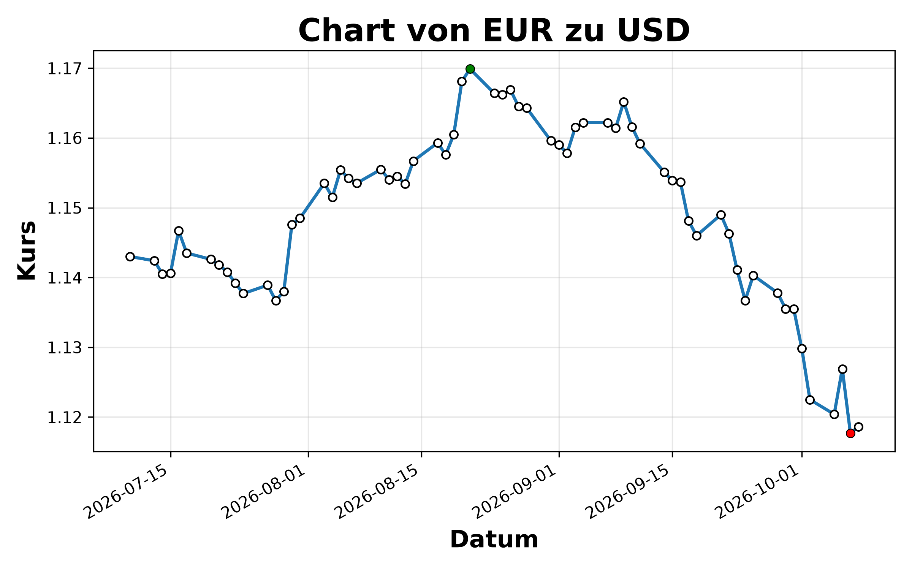

# Kursreport

Kleines Python-Tool, das historische Wechselkurse über eine öffentliche API abruft, die wichtigsten Kennzahlen berechnet und einen Chart als PNG speichert.



## Was es macht

- Holt Wechselkurse für ein frei wählbares Währungspaar und einen frei wählbaren Zeitraum
- Berechnet Startkurs, Endkurs, Höchst- und Tiefstkurs (mit Datum) sowie die Veränderung in Prozent
- Zeichnet den Kursverlauf mit markiertem Hoch (grün) und Tief (rot)
- Speichert den Chart als `BASIS-ZIEL.png`, z.B. `EUR-USD.png`

## Hintergrund

Entstanden als Übungsprojekt um API integration in Python zu lernen

## Datenquelle

[Frankfurter API](https://frankfurter.dev): kostenlos, Open Source, kein API-Key nötig. Die Kurse basieren auf den Referenzkursen der Europäischen Zentralbank und werden nur an Werktagen veröffentlicht.

## Technik

- `requests` für den API-Abruf
- `pandas` für Zeitreihe und Kennzahlen
- `matplotlib` für den Chart

## Installation

Voraussetzung: Python 3.10 oder neuer.

```bash
git clone <repo-url>
cd kursreport
python -m venv venv
```

venv aktivieren:

```bash
# Windows
venv\Scripts\activate

# Mac / Linux
source venv/bin/activate
```

Abhängigkeiten installieren:

```bash
pip install -r requirements.txt
```

## Benutzung

```bash
python kursreport.py
```

Währungspaar und Zeitraum werden im Aufruf am Ende von `kursreport.py` festgelegt:

```python
main("EUR", "USD", 90)   # Basis, Ziel, Anzahl Tage
```

Beispielausgabe:

```
Höchste: 2026-08-21 1.1700
Tiefste: 2026-10-07 1.1177
Start kurs lag bei 1.1430
End kurs lag bei 1.1187
Der Kurs hat sich um -2.13% verändert
```

